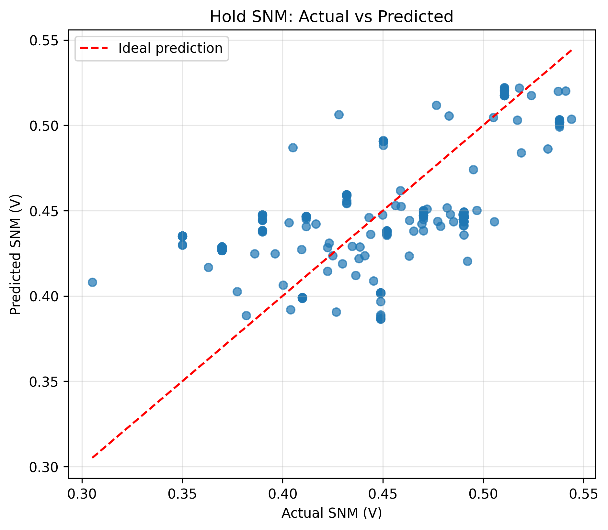
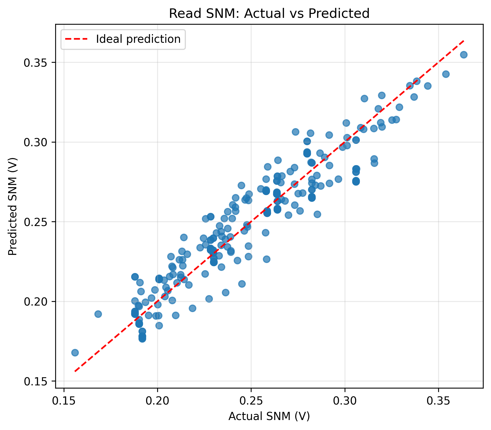

# SRAM Stability and Failure Probability Analysis

**An AI/ML-driven analysis of SRAM stability, fault classification, and Static Noise Margin (SNM) predi

https://github.com/user-attachments/assets/75e78a76-33e4-4f05-bc1a-3f5d3e5b9cd5


ction across Process, Voltage, and Temperature (PVT) variations.**

<p align="center">
  
  
</p>

## Overview

SRAM reliability is strongly influenced by process variations, supply voltage, temperature, and manufacturing defects. These variations can affect cell stability, read/write operations, and overall memory reliability.

This project investigates SRAM stability using data analysis and machine learning techniques. It focuses on understanding fault characteristics, predicting Static Noise Margin (SNM), classifying SRAM fault conditions, and evaluating model performance across different PVT corners.

The project combines statistical analysis, feature engineering, supervised machine learning, and model explainability to study the relationship between electrical characteristics and SRAM failure behavior.

## Objectives

- Analyze SRAM electrical characteristics under different PVT conditions.
- Study the impact of different fault mechanisms on SRAM stability.
- Perform data cleaning, exploratory data analysis, and statistical testing.
- Extract meaningful features from electrical measurements.
- Develop regression models for SNM prediction.
- Build machine learning models for SRAM fault classification.
- Evaluate model generalization across different PVT corners.
- Interpret model predictions using explainability techniques.

## Fault Categories

The dataset contains five fault classes:

| Class | Fault Type |
|---|---|
| 0 | Healthy |
| 1 | Resistive Open |
| 2 | Bridging |
| 3 | Storage Vth Drift |
| 4 | Access Vth Drift |

## Dataset

The project uses an SRAM fault dataset containing **450 samples and 33 features**, covering 15 PVT corners.

Important parameters include:

- Supply voltage (`vdd_v`)
- Temperature (`temperature_c`)
- Drain current (`i_ddq_uA`)
- Write delay (`t_write_ps`)
- Write peak current (`i_write_peak_mA`)
- Bit-line voltage difference (`dv_bl_strobe_mV`)
- Hold SNM (`snm_hold_v`)
- Read SNM (`snm_read_v`)
- Stability and operation indicators

The dataset includes electrical measurements, fault labels, PVT information, and simulation-related indicators.

## Project Workflow

### 1. Data Understanding
- Dataset inspection and structural analysis.
- Feature distributions and descriptive statistics.
- Fault class and PVT composition analysis.

### 2. Data Cleaning
- Missing-value and duplicate analysis.
- Identification of anomalous and unreliable measurements.
- Examination of simulation convergence.

### 3. Exploratory Data Analysis
- Feature distributions.
- Correlation analysis.
- Fault-wise electrical characteristic comparisons.
- PVT-dependent behavior analysis.

### 4. Statistical Analysis
- Descriptive statistics.
- Non-parametric statistical testing.
- Dunn post-hoc analysis.
- Effect-size analysis.
- Spearman correlation analysis.

### 5. Feature Engineering
- Feature transformation and normalization.
- Creation of derived electrical features.
- Feature redundancy analysis.
- Selection of relevant model inputs.

### 6. SNM Regression
Regression models were developed to estimate SRAM stability through Static Noise Margin.

Models investigated:
- Linear Regression
- Random Forest Regression

Evaluation metrics:
- Mean Absolute Error (MAE)
- Root Mean Squared Error (RMSE)
- R² Score

### 7. Fault Classification
Machine learning models were developed to distinguish SRAM fault conditions.

Models investigated:
- Logistic Regression
- Random Forest
- XGBoost

Evaluation metrics:
- Accuracy
- Precision
- Recall
- F1-score
- Balanced Accuracy

Group-aware cross-validation using PVT corner information was used to investigate generalization across corners.

### 8. Model Explainability
Feature importance and SHAP-based analysis were used to understand which electrical characteristics influence model predictions.

## Machine Learning Results

The regularized Random Forest classifier achieved the following mean grouped cross-validation results:

| Model | Accuracy | Macro F1 |
|---|---:|---:|
| Random Forest | 82.22% | 0.6828 |
| Regularized Random Forest | 81.33% | 0.7112 |
| XGBoost | 80.67% | 0.6848 |

The regularized Random Forest achieved the highest macro F1 among these models.

### SNM Regression Results

| Target | Model | MAE | RMSE | R² |
|---|---|---:|---:|---:|
| Hold SNM | Linear Regression | 0.03081 | 0.04630 | 0.92662 |
| Hold SNM | Random Forest | 0.03114 | 0.04256 | 0.93720 |
| Read SNM | Linear Regression | 0.06076 | 0.08153 | 0.47977 |
| Read SNM | Random Forest | 0.06899 | 0.10535 | 0.15072 |

*Note: These regression results are from the earlier evaluation experiments. They should not be interpreted as equivalent to the later grouped classification validation.*

## Repository Structure

```text
SRAM_IIITDM_DSPROJECT/
│
├── data/
│   ├── raw/
│   ├── processed/
│   └── *.csv
│
├── notebooks/
│   ├── 01_data_understanding.ipynb
│   ├── 02_data_cleaning.ipynb
│   ├── 03_exploratory_data_analysis.ipynb
│   ├── 04_statistical_analysis.ipynb
│   ├── 05_feature_engineering.ipynb
│   ├── 06_snm_regression.ipynb
│   ├── 07_failure_classification.ipynb
│   └── 08_model_explainability.ipynb
│
├── models/
│   ├── hold_snm_regression.pkl
│   ├── read_snm_regression.pkl
│   ├── sram_fault_classifier.pkl
│   └── feature_columns.pkl
│
├── reports/
│   ├── figures/
│   ├── model_results/
│   └── *.csv
│
├── src/
│   ├── analysis/
│   ├── data/
│   ├── evaluation/
│   ├── features/
│   └── models/
│
├── README.md
└── requirements.txt
```

## Installation and Setup

### 1. Clone the repository

```bash
git clone https://github.com/adityaprasadmisra/SRAM_IIITDM_DSPROJECT.git

cd SRAM_IIITDM_DSPROJECT
```

### 2. Create a virtual environment

Windows:

```powershell
python -m venv venv
venv\Scripts\activate
```

Linux/macOS:

```bash
python3 -m venv venv
source venv/bin/activate
```

### 3. Install dependencies

```bash
pip install -r requirements.txt
```

### 4. Launch Jupyter Notebook

```bash
jupyter notebook
```

Open the notebooks directory and execute the notebooks in numerical order.

## Technologies Used

| Category | Technologies |
|---|---|
| Programming | Python |
| Data Processing | Pandas, NumPy |
| Visualization | Matplotlib, Seaborn |
| Statistical Analysis | SciPy, Scikit-posthocs |
| Machine Learning | Scikit-learn, XGBoost |
| Explainability | SHAP |
| Development | Jupyter Notebook, VS Code |
| Version Control | Git, GitHub |

## Key Findings and Limitations

- SRAM electrical characteristics exhibit different patterns across fault categories.
- PVT variation is an important factor in SRAM stability analysis.
- Group-aware validation provides a more meaningful assessment of cross-corner generalization than random splitting.
- Some fault categories have limited sample counts.
- Simulation non-convergence can introduce bias into model evaluation.
- Certain features may contain fault-specific information that improves classification but may not generalize to unseen simulation conditions.
- SHAP feature importance describes model behavior, not physical causality.

The results are based on the available simulation dataset and should not be interpreted as validated performance on fabricated silicon or real-world SRAM hardware.

## Future Work

- Expand the dataset across additional PVT corners.
- Improve simulation convergence and data reliability.
- Investigate more robust cross-corner generalization techniques.
- Explore calibrated failure-probability estimation.
- Integrate the trained models into an interactive SRAM analysis dashboard.
- Validate predictions using additional circuit simulations and experimental measurements.

## Authors

**SRAM Intelligence / IIITDM Kancheepuram**

Developed as an academic project focused on SRAM reliability, statistical analysis, and machine learning.

## Acknowledgements

The project builds on SRAM simulation concepts and electrical characterization techniques, with external source material and simulation references to be acknowledged in accordance with their respective licenses.

---

**Project Focus:** SRAM Reliability | Static Noise Margin | PVT Variation | Fault Classification | Machine Learning | Explainable AI
